# Plano Técnico — Aplicação de Previsão do Tempo

Fonte da verdade: [especificação do produto](../specs/weather-app-spec.md). Este
plano define arquitetura e contratos para os requisitos RF-01 a RF-05 e RNF-01 a
RNF-08; não substitui nem amplia o escopo da especificação.

## Architecture

Aplicação cliente em React, organizada em camadas com dependências direcionadas:

```text
components (apresentação)
       ↓ eventos / props
hooks (estado e orquestração)
       ↓ chamadas de dados         ↘ funções puras
services (Open-Meteo) ───────────→ lib (conversão, formatação, mapeamento)
       ↓
Geocoding API / Forecast API
```

Fluxo de busca e consulta meteorológica:

```mermaid
flowchart LR
  Search[Busca na UI] -->|texto enviado| GeoService[Geocoding service]
  GeoService -->|resultados ou erro| SearchState[Hook / estado da busca]
  SearchState -->|resultados, vazio ou erro| ResultsUI[UI de resultados]
  ResultsUI -->|cidade escolhida| WeatherService[Forecast service]
  WeatherService -->|dados ou erro| WeatherState[Hook / estado meteorológico]
  WeatherState -->|clima, loading ou erro| WeatherUI[UI do clima]
```



- **Apresentação (`components/`):** componentes recebem dados e callbacks por
  props, renderizam a interface acessível e emitem ações. Não contêm chamadas
  HTTP nem regras de conversão.
- **Orquestração (`hooks/`):** hooks coordenam busca, seleção, consulta atual,
  loading/erro/vazio, retry e unidade durante a sessão. Chamam serviços e
  fornecem estado e ações aos componentes.
- **Acesso a dados (`services/`):** funções encapsulam endpoints Open-Meteo,
  parâmetros, timeout, erros HTTP/rede e validação do formato externo. Retornam
  modelos compartilhados, sem conhecer componentes React.
- **Funções puras (`lib/`):** utilitários determinísticos fazem conversão e
  arredondamento de temperaturas, mapeamento de códigos WMO e formatação de
  datas/horários. Não acessam rede, estado React ou DOM.
- **Contratos (`types/`):** tipos compartilhados entre hooks, serviços e UI.
- **Dependências:** componentes → hooks → services/lib; services podem reutilizar
  funções puras de `lib/`, mas `lib/` não depende das outras camadas. Não há
  servidor próprio.
- **Rastreabilidade:** RF-01 corresponde a busca e seleção; RF-02 e RF-03 aos
  dados meteorológicos; RF-04 à apresentação da unidade; RF-05 aos estados,
  timeout e tentativas. Responsividade, acessibilidade, idioma, privacidade,
  compatibilidade e desempenho seguem RNF-01 a RNF-08.

## Tech Stack

- **TypeScript strict:** contratos tipados para dados externos, domínio e estado.
- **React + Vite:** interface cliente e desenvolvimento/build.
- **Tailwind CSS:** layout responsivo e apresentação dark glassmorphism conforme
  a stack do projeto; respeitar contraste, foco visível e outros critérios WCAG
  2.2 AA.
- **Vitest + Testing Library:** testes unitários e de componentes.
- **Playwright:** testes dos fluxos ponta a ponta e da matriz de navegadores.
- **Open-Meteo:** geocodificação e previsão sem chave de API.
- **pnpm + Biome:** gerenciamento de pacotes, lint e formatação conforme
  convenções do projeto.

## Project Structure

Estrutura proposta, compatível com as convenções do repositório:

```text
src/
  components/
    SearchForm.tsx
    CityResults.tsx
    CurrentWeather.tsx
    ForecastList.tsx
    TemperatureUnitToggle.tsx
    QueryStatus.tsx
  hooks/
    useWeatherSearch.ts
  services/
    geocodingService.ts
    forecastService.ts
  lib/
    temperature.ts
    weatherCode.ts
    dateTime.ts
  types/
    weather.ts
  App.tsx
tests/
  unit/
    lib/
    services/
    hooks/
    components/
  e2e/
```

- `components/`: formulário, resultados, condições atuais, previsão, seletor de
  unidade e status; apresentação e interação acessível, sem chamadas HTTP.
- `hooks/`: estado efêmero e coordenação das operações, sem duplicar regras de
  transporte ou lógica pura.
- `services/`: `geocodingService.ts` e `forecastService.ts` mantêm cada contrato
  de API, timeout, tratamento de falha e validação de payload.
- `lib/`: funções sem efeitos colaterais, agrupadas por responsabilidade:
  conversão/arredondamento, mapeamento WMO e formatação de data/hora.
- `types/`: modelos normalizados compartilhados; tipos TypeScript não substituem
  validação em runtime das respostas externas.
- `App.tsx`: compõe a tela e conecta os hooks aos componentes.
- `tests/`: testar `lib/` diretamente com entradas/saídas determinísticas;
  testar `services/` com `fetch` simulado, timeout e payloads inválidos; testar
  hooks isolando os serviços; testar componentes por comportamento acessível e
  reservar E2E para os fluxos completos. A separação permite localizar falhas
  por camada e evita depender da API real em testes unitários.

## Data Model

Contratos de domínio (não são os tipos JSON brutos do provedor):

```ts
type Unit = "celsius" | "fahrenheit";

interface City {
  /** ID da localidade retornado pela geocodificação. */
  id: number;
  /** Nome da cidade retornado pela geocodificação. */
  name: string;
  /** Região administrativa, quando disponível. */
  admin1: string | null;
  /** Nome do país, quando disponível. */
  country: string | null;
  /** Latitude usada na consulta meteorológica. */
  latitude: number;
  /** Longitude usada na consulta meteorológica. */
  longitude: number;
}

interface CurrentWeather {
  /** Temperatura atual normalizada em Celsius. */
  temperatureC: number | null;
  /** Código meteorológico WMO do Open-Meteo. */
  weatherCode: number | null;
  /** Horário da observação retornado pelo provedor. */
  observedAt: string | null;
  humidityPercent: number | null;
  windSpeedKmh: number | null;
  precipitationMm: number | null;
  pressureHpa: number | null;
}

interface ForecastDay {
  /** Data local retornada na previsão diária. */
  date: string;
  /** Código WMO da condição diária. */
  weatherCode: number | null;
  /** Temperatura mínima diária em Celsius. */
  minimumC: number | null;
  /** Temperatura máxima diária em Celsius. */
  maximumC: number | null;
  precipitationProbabilityPercent: number | null;
}

interface WeatherData {
  /** Localidade escolhida explicitamente pela pessoa usuária. */
  city: City;
  /** Fuso horário da cidade retornado pela API de previsão. */
  timezone: string | null;
  /** Condições atuais; validar a atualidade antes de exibir. */
  current: CurrentWeather;
  /** Cinco dias locais, ou null se fuso ou previsão estiver indisponível. */
  forecast: ForecastDay[] | null;
}
```

- Respostas externas são opcionais/parciais até validação; valores numéricos
  precisam ser finitos. Campos inválidos ou ausentes tornam-se `null`, nunca
  valores presumidos ou herdados de uma consulta anterior.
- `observedAt` deve ser validado antes de apresentar dados como atuais: timestamp
  válido, não futuro e com no máximo duas horas. Caso contrário, não apresentar
  temperatura ou condição como atuais.
- `forecast` contém os cinco dias locais consecutivos, começando pela data local
  de hoje. Cada campo pode estar indisponível; sem fuso ou sem previsão diária
  válida, a previsão inteira é `null`.
- Valores de temperatura são mantidos em Celsius no modelo. Converter apenas na
  apresentação para evitar conversões cumulativas ao alternar unidades.
- Umidade e probabilidade de precipitação são percentuais entre 0 e 100; vento,
  precipitação e pressão são valores não negativos. Valores ausentes ou
  inválidos são `null` e apresentados como indisponíveis independentemente.
- Código WMO desconhecido permanece indisponível; usar o mapeamento pt-BR
  completo definido na spec, sem esconder temperaturas válidas.
- `id` e coordenadas vêm do resultado escolhido na geocodificação. Não selecionar
  resultados automaticamente nem consultar coordenadas diferentes das escolhidas.

## Data Flow

1. A pessoa envia explicitamente o formulário. Validar texto vazio após
   `trim()`; nesse caso mostrar validação e não chamar a API. Preservar todos os
   caracteres internos do nome.
2. O serviço de geocodificação envia uma única chamada. Validar a resposta e
   manter a ordem de relevância; apresentar no máximo cinco resultados, com os
   campos geográficos disponíveis e coordenadas quando nome homônimo não tiver
   região ou país.
3. Ao selecionar resultado, definir a cidade selecionada e solicitar a previsão
   para suas coordenadas. Não consultar as outras opções.
4. O serviço normaliza os dados atuais e diários. A previsão usa as datas e o
   fuso da cidade, não o calendário local do dispositivo. A interface mostra
   campos indisponíveis explicitamente e atribui os dados ao Open-Meteo.
5. A alternância de unidade atualiza somente temperaturas e rótulos; cidade,
   condições, datas e disponibilidade permanecem iguais. Celsius é o valor
   inicial em cada sessão.
6. Retry manual repete somente a operação que falhou: busca com o mesmo texto ou
   meteorologia para a mesma cidade selecionada.

## External APIs

Usar HTTPS e codificar os valores dos parâmetros com `URLSearchParams`.

- **Geocoding —** `GET
  https://geocoding-api.open-meteo.com/v1/search?name={cidade}&count=5&language=pt`
  - `name`: texto pesquisado após remover espaços externos; caracteres internos
    são preservados.
  - `count=5`: limita os resultados do provedor a cinco; manter a ordem de
    relevância retornada.
  - `language=pt`: solicita nomes localizados em português quando disponíveis.
  - Normalizar `id`, `name`, `admin1`, `country`, `latitude` e `longitude`;
    região administrativa e país podem estar ausentes.
- **Forecast —** `GET
  https://api.open-meteo.com/v1/forecast?latitude={lat}&longitude={lon}&current=temperature_2m,weather_code,relative_humidity_2m,wind_speed_10m,precipitation,pressure_msl&daily=weather_code,temperature_2m_max,temperature_2m_min,precipitation_probability_max&timezone=auto&temperature_unit=celsius&wind_speed_unit=kmh&precipitation_unit=mm&forecast_days=5`
  - `latitude` e `longitude`: coordenadas da localidade escolhida na busca.
  - `current=temperature_2m,weather_code`: solicita temperatura e código WMO
    atuais; `current.time` da resposta fornece o horário da observação.
    Os demais campos atuais fornecem umidade, vento, precipitação e pressão.
  - `daily=weather_code,temperature_2m_max,temperature_2m_min`: solicita código
    WMO e temperaturas mínima/máxima para cada dia.
    `precipitation_probability_max` fornece a probabilidade máxima diária.
  - `timezone=auto`: solicita o fuso horário correspondente às coordenadas para
    que as datas diárias sejam locais.
  - `temperature_unit=celsius` e `forecast_days=5`: mantêm os valores-fonte em
    Celsius e pedem hoje mais os quatro dias seguintes, conforme a spec.

Validar os campos atuais, datas e arrays diários individualmente. Dados ausentes
não invalidam campos independentes. O fuso retornado é necessário para
apresentar a previsão, mas sua ausência não invalida por si só o clima atual se
houver horário utilizável.
- Cada chamada tem timeout de 10 segundos. Não há repetição automática nem cache.
  Validar resposta HTTP, JSON, estrutura e valores antes de atualizar a interface.
- O horário retornado pela API deve ser interpretado e apresentado no fuso da
  cidade quando disponível, usando o offset retornado para validar a idade da
  observação. Não depender do fuso configurado no dispositivo.
- A UI informa que o nome de busca é enviado ao Open-Meteo e atribui os dados ao
  provedor. Confirmar os termos vigentes do serviço antes da publicação.

## State Management

Manter estado efêmero em `useWeatherSearch` (ou hook equivalente) na página; não
usar armazenamento local, cookies, URL persistente ou backend. Separar o estado
da busca e o da consulta meteorológica para que cada operação exponha um estado
explícito:

```ts
type OperationState<T> =
  | { status: "idle" }
  | { status: "loading" }
  | { status: "success"; data: T }
  | { status: "empty" }
  | { status: "error"; error: QueryError };

type QueryError =
  | "timeout"
  | "network"
  | "http"
  | "invalid-response";
```

O hook mantém o texto digitado, `searchState`, cidade selecionada,
`weatherState` e a unidade (`Unit`, inicializada como `"celsius"`). `idle`
representa uma operação ainda não iniciada; `loading`, uma chamada em curso;
`success`, dados válidos (inclusive respostas meteorológicas parciais);
`empty`, busca bem-sucedida sem cidades; `error`, falha técnica recuperável.
Desabilitar envios duplicados enquanto a operação correspondente está em
`loading`. Ao consultar outra cidade, limpar os dados meteorológicos anteriores;
em falha, preservar a cidade selecionada para retry, mas nunca apresentar dados
antigos como resultado da nova consulta.

Armazenar temperaturas recebidas normalizadas em Celsius. A unidade escolhida é
estado de apresentação; derivar os valores durante a renderização a partir dos
valores Celsius originais, sem alterar `WeatherData` e sem fazer nova chamada:

```ts
const converted =
  unit === "fahrenheit" ? (temperatureC * 9) / 5 + 32 : temperatureC;
const displayed = Math.sign(converted) * Math.floor(Math.abs(converted) + 0.5);
```

Aplicar a conversão a cada temperatura atual e mínima/máxima diária; valores
`null` continuam “Indisponível”. A função de conversão pode residir em `lib/` e
ser chamada na renderização/seletor. Ao alternar de volta, recalcular do Celsius
original, não do número Fahrenheit já convertido. A alternância modifica apenas
valores e rótulos da unidade, sem requisitar dados.

## Error Handling

- **Rede:** falhas de conexão viram `error: "network"`; encerrar o loading,
  explicar que a operação não foi concluída e oferecer retry manual.
- **API/HTTP:** respostas HTTP não bem-sucedidas, inclusive limite excedido,
  viram `error: "http"`. Não repetir automaticamente; retry faz uma única nova
  chamada da operação.
- **Timeout:** abortar a chamada após 10 segundos, apresentar `error: "timeout"`
  e oferecer retry manual, sem repetição automática.
- **Resposta inválida:** falha de JSON ou payload incompatível com o contrato vira
  `error: "invalid-response"`; não tratar como sucesso vazio nem ocultar o erro.
- **Busca vazia:** resposta de geocodificação válida sem resultados usa o estado
  `empty` e informa “Cidade não encontrada”; manter o campo editável. Texto em
  branco é validado antes da chamada e não inicia operação.
- **Resposta meteorológica parcial:** não é falha HTTP se a estrutura puder ser
  processada. Manter `success`, exibir cada campo válido e “Indisponível” nos
  campos ausentes, sem reutilizar dados da consulta anterior.
- **Dados atuais inválidos ou vencidos:** timestamp ausente/inválido, futuro ou
  com mais de duas horas impede apresentar temperatura/condição como atuais;
  informar que estão desatualizados ou indisponíveis.
- **Previsão indisponível:** sem fuso não apresentar previsão. Sem previsão
  diária válida, indicar indisponibilidade; quando fuso e intervalo forem
  conhecidos, manter os cinco cartões e sinalizar campos/datas ausentes.
- **Código WMO desconhecido:** apresentar “Condição indisponível”, mantendo
  temperaturas válidas.
- **Retry e dados antigos:** repetir a busca com o mesmo texto ou a consulta para
  a mesma cidade selecionada. Preservar a cidade em erro meteorológico, limpar
  os dados anteriores ao iniciar uma consulta nova e só apresentar os dados
  retornados por ela.
- Mensagens de carregamento e erro devem ser anunciáveis por tecnologia
  assistiva; controles de retry e seleção devem ser utilizáveis por teclado e
  expor nomes e foco acessíveis.

## Testing Strategy

- **Unitários (Vitest):** normalização e validação de payloads; vazios, erros e
  campos parciais; códigos WMO reconhecidos/desconhecidos; timestamp futuro,
  inválido, com mais de duas horas e no limite de idade; datas/fuso; conversão
  Celsius/Fahrenheit incluindo empate afastando-se de zero e valores negativos;
  timeout e ausência de retries automáticos.
- **Componentes (Testing Library):** submissão vazia sem chamada, trim e
  preservação de Unicode/caracteres internos, máximo de cinco resultados,
  distinção de homônimos, loading/erro/vazio, retry e preservação da cidade,
  estados parciais, atribuição, aviso de privacidade, alternância sem alterar
  outros dados e acessibilidade por teclado/roles/labels.
- **E2E (Playwright):** busca → escolha explícita → clima atual e cinco dias →
  alternância; busca sem resultados; timeout/falha e retry; respostas parciais;
  verificar que uma cidade não herda dados de outra.
- Usar respostas simuladas para cenários determinísticos. Reservar chamadas reais
  para verificação controlada de integração, sem tornar os testes de rotina
  dependentes da disponibilidade do provedor.
- Validar RNF-01 em larguras de 320 a 1920 CSS px e orientação retrato/paisagem;
  RNF-05 com testes automatizados e revisão manual; RNF-06 nas versões estáveis
  alvo especificadas para desktop e mobile.
- Medir RNF-03 em 100 consultas bem-sucedidas nas condições definidas pela spec
  (viewport 1366 × 768, RTT 50 ms, provedor até 1,5 s), separando latência do
  provedor e validando p95 de até 2,5 s entre envio e renderização do clima.
- RNF-02 requer teste moderado com cinco participantes e meta de pelo menos
  quatro conclusões sem ajuda em até 30 segundos. RNF-04 requer monitoramento
  sintético a cada minuto e apuração mensal de disponibilidade; isso é atividade
  operacional, sem adicionar analytics ou identificadores de usuário.

## Risks & Trade-offs

| Risco / trade-off | Decisão e mitigação |
|---|---|
| Rate limiting ou indisponibilidade do Open-Meteo | Uma chamada por ação, sem retry automático ou cache; timeout de 10 s e tentativa manual. |
| Resultados homônimos ou geocodificação imprecisa | Exibir contexto geográfico e exigir seleção explícita; permitir nova busca. |
| Resposta parcial, inválida ou desatualizada | Validar/normalizar no serviço e indicar indisponibilidade sem inventar ou reutilizar dados. |
| Datas ou horário interpretados no fuso errado | Usar o fuso e calendário retornados pelo provedor; nunca usar o fuso do dispositivo como substituto para previsão. |
| Conversão ou arredondamento de temperatura inconsistente | Conservar Celsius como origem e testar a fórmula e o empate afastando-se de zero em ambos os sinais. |
| Ausência de cache reduz disponibilidade percebida | Trade-off intencional da spec para não exibir dados antigos nem persistir dados meteorológicos; erro e retry manual são a recuperação. |
| Contrato ou cobertura da API muda | Validar respostas externas, tratar dados indisponíveis explicitamente e rever integração/termos antes de publicar. |
| Termos do provedor incompatíveis com o uso pretendido | Verificar termos vigentes e atribuição antes da publicação; não publicar se incompatível. |
| Testes E2E reais são instáveis | Simular API nos fluxos automatizados e manter verificação de integração separada e controlada. |
| Monitoramento de disponibilidade vs. privacidade | Usar verificações sintéticas sem dados de usuário, analytics, cookies de rastreamento ou persistência de busca. |
